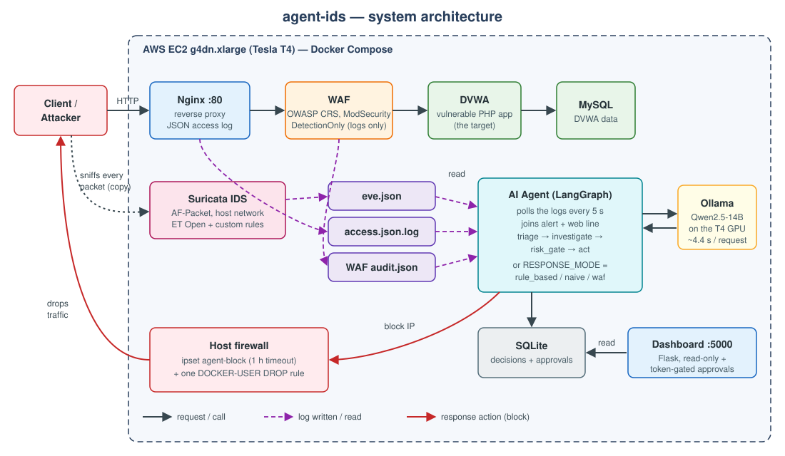
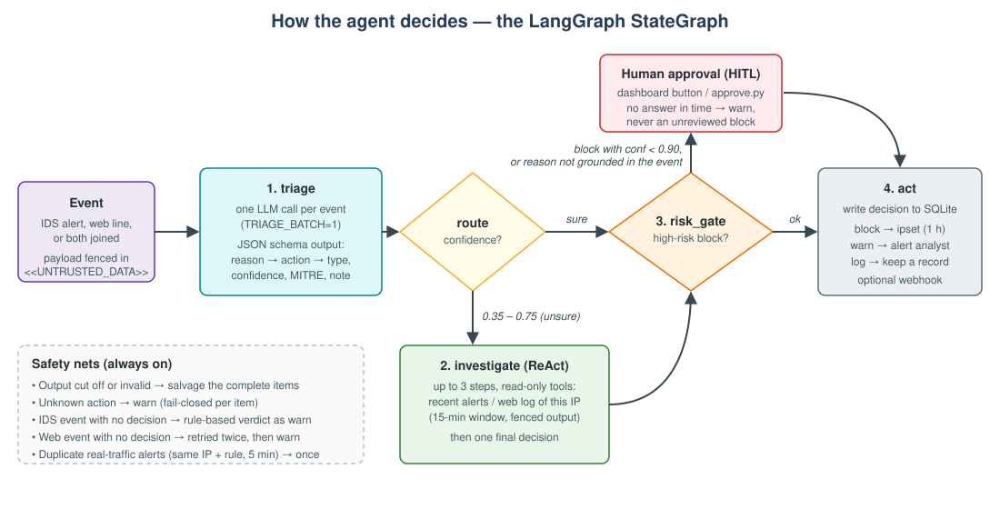
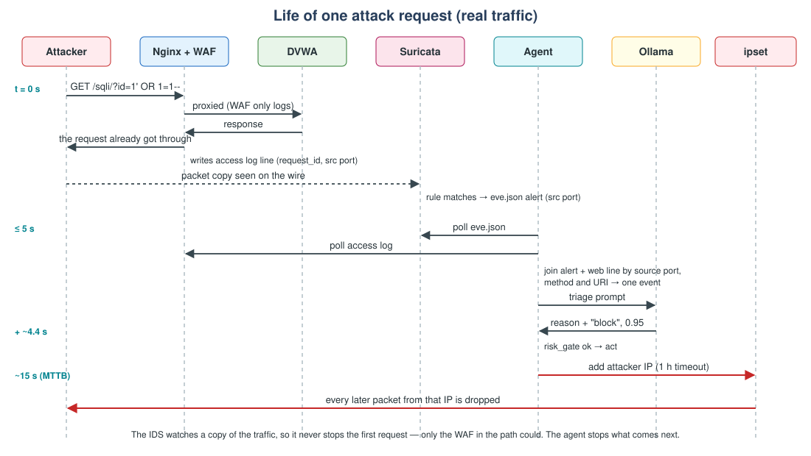

### 1. The big picture

A request from a client goes **Nginx → WAF → DVWA**. Along the way, three logs are written:

| Log | Written by | What it contains |
|---|---|---|
| `eve.json` | Suricata | An alert when a packet matches a rule (signature, severity, source IP/port) |
| `access.json.log` | Nginx | **Every** request: method, URI, body, status, `request_id`, source port |
| `audit.json` | WAF | The CRS rules that matched, and whether the anomaly score crossed the blocking threshold |

The agent container **polls these logs every 5 seconds**. It runs with the host network so it can manage the host
firewall.

### 2. Why read two sources?

This is the key design idea.

- **Suricata** produces high-signal alerts, but misses anything its rules do not describe (encoded payloads, single
  requests that are only suspicious as part of a series).
- **The Nginx access log** contains every request, including the ones Suricata stayed silent about.

The agent reads both. When an alert and a web-log line describe the **same request**, they are joined into one event
(by source port, method and URI) so the model sees the full picture once. Requests that only appear in the web log are
still judged — that is where most of the agent's extra catches come from.

To prove that, the benchmark also runs `agent_ids`: the **same LLM and graph, but only Suricata alerts as input**. It
scores almost exactly like the plain IDS, which shows the gain comes from the data source, not from the model second-
guessing alerts.

### 3. How the agent decides

Each event goes through a LangGraph `StateGraph`:

1. **triage** — one LLM call per event. The model must answer in a strict JSON schema (enforced by Ollama's grammar):
   - `reason` — written **first**: the attack syntax it found, or the ordinary value it saw;
   - `action` — `block`, `warn` or `log`;
   - `attack_type`, `confidence` (= probability that it is an attack), `mitre_technique`, `severity`, `analyst_note`.
2. **route** — if the model is unsure (confidence between 0.35 and 0.75), the event goes to **investigate**.
3. **investigate** — a short ReAct loop (at most 3 steps) where the model may call **read-only tools**: recent alerts and
   web-log lines from the same IP in the last 15 minutes. Tools can only *look*; they can never block anything.
4. **risk_gate** — a `block` with confidence below 0.90, or whose reason cites evidence that is not in the event (for
   example "IDS severity 1" when there was no alert), waits for a **human**. Unanswered items become `warn` after
   15 minutes — the system never blocks without either high confidence or a person saying yes.
5. **act** — the decision is written to SQLite; a `block` adds the IP to an `ipset` with a one-hour timeout.

**Why the reason comes before the action:** with the reason written last, the model picked the action from surface clues
(a page named `fi` "must be" file inclusion) and justified it afterwards. Making it state its evidence first removed six
false positives on the test set.

**Prompt-injection defense:** request content is attacker-controlled text. It is wrapped in `<<UNTRUSTED_DATA>>` markers
and the system prompt tells the model to treat anything inside as data, never as instructions. Tool output and memory
lessons are fenced the same way.

### 4. The life of one attack request

1. The attacker sends a request; Nginx and the WAF pass it to DVWA. **The first request always gets through** — the IDS
   only sees a copy of the traffic.
2. Nginx writes the access-log line; Suricata matches a rule and writes an alert.
3. Within 5 seconds the agent picks both up and joins them.
4. The model answers in about 4.4 seconds.
5. The IP is added to the block list. Every later packet from it is dropped. End to end this takes **about 15 seconds**
   (the MTTB — mean time to block — in the benchmark).

### 5. The five decision modes

The same running stack can make decisions in five ways, selected with `RESPONSE_MODE`:

| Mode | How it decides | Why it is there |
|---|---|---|
| `rule_based` | Suricata alert with severity ≤ 2 → block | The classic IDS + auto-response |
| `naive` | Every Suricata alert → block | A crude "block everything" baseline |
| `waf` | CRS anomaly threshold exceeded (rule `949110`) → attack | What most companies actually use for web attacks |
| `agent` | LLM graph, alerts + web log | The proposed method |
| `agent_ids` | LLM graph, alerts only | Ablation: separates "sees more" from "reasons better" |

### 6. Optional: experience memory

With `MEMORY_ENABLED=true`, the agent stores past decisions and the feedback it got (for example a human marking a block
as a false positive). For a new event it retrieves the three most similar past cases (embeddings from
`nomic-embed-text`) as examples. The benchmark measured whether this helps — it did not, measurably (see
[Results](../2.7-results/)).
