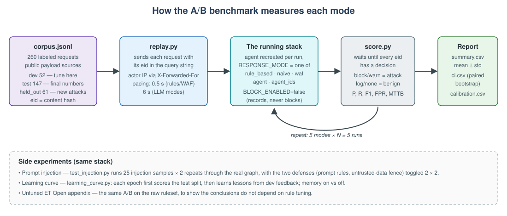

The benchmark is what turns this from a demo into an experiment. It answers "is the agent better?" with numbers that
another person can reproduce.



### 1. The corpus

`benchmark/attack_corpus/corpus.jsonl` holds **260 labeled HTTP requests**, built by `build_corpus.py` from two data files:

| Group | What it is | Why it is there |
|---|---|---|
| `clear_attack` | textbook SQLi, XSS, command injection, LFI, RFI | the IDS should catch these |
| `evasion` | the same attacks, encoded or obfuscated | where rules usually fail |
| `recon` | a directory scan and a password-guessing burst | attacks spread over many requests |
| `benign_normal` | ordinary use of the same DVWA pages | false-positive check |
| `fp_bait` | harmless text that *contains* attack keywords ("what is a UNION SELECT?") | the hardest false-positive check |
| `held_out` | 61 new attacks, never replayed while tuning | a final, untouched recall test |

Payloads come from **public sources** (PayloadsAllTheThings, PortSwigger, OWASP, SecLists), not written by the
author — so the corpus is not "built for the AI to win".

The rows are split into **dev** (52 — tune the prompt here), **test** (147 — final numbers only) and **held_out** (61).
Variants of the same technique always stay in the same split, so tuning on dev cannot leak test answers.

### 2. How one run works

1. The agent container is **recreated** with the chosen `RESPONSE_MODE` and `BLOCK_ENABLED=false` (record, never block —
   otherwise the replay would block itself).
2. `replay.py` sends the requests in a fixed order. Each carries a unique `eid` in its query string, and an actor IP in
   `X-Forwarded-For` so requests look like they come from different clients.
3. `score.py` **waits until every request has a decision** (a slow run shows up as latency, never as "missed attacks"),
   then compares with the labels: `block`/`warn` = detected, `log`/no decision = benign.
4. It writes Precision, Recall, F1, FPR, MTTB (mean time to block), p95 latency and per-group scores.

`run_ab.sh` repeats this for all five modes, five times each, then computes:

- `summary.csv` — mean ± std per mode;
- `ci.csv` — 95% confidence intervals from a **request-paired bootstrap** (resample the requests, same sample for every
  mode). A difference counts as evidence only when its interval excludes 0;
- `calibration.csv` — does `confidence` match how often the model is right?

### 3. Run it

On the EC2 instance, from `~/agent-ids`, with the GPU checked first:

```bash
docker exec ollama nvidia-smi -L

# tuning loop: dev split, 2 runs per mode
REPORT_TAG=dev-1 SPLIT=dev N=2 bash benchmark/run_ab.sh

# final numbers: test split, 5 runs per mode (~3 hours)
REPORT_TAG=test-final SPLIT=test N=5 bash benchmark/run_ab.sh

# untouched new attacks, once, at the very end (~1.3 hours)
REPORT_TAG=held-out SPLIT=held_out N=5 bash benchmark/run_ab.sh
```

Results land in `benchmark/report/<REPORT_TAG>/`.

{}
Long runs: start them with `nohup ... > /tmp/ab.log 2>&1 < /dev/null &` and check progress with **short** SSH calls
every minute or two. A single SSH session left waiting for hours tends to be reset by the network, and you only notice
much later.
{}

### 4. Why it takes hours

The LLM needs about **4.4 seconds per request** on a T4. The replay sends one request every **6 seconds** in the LLM
modes so the model is never behind; otherwise MTTB would measure the queue instead of the agent. One agent run over the
test split is therefore ~15 minutes, and 2 LLM modes × 5 runs is already 2.5 hours. Rule and WAF modes take under two
minutes per run.

### 5. Side experiments

**Prompt injection (Pillar 3).** Attack requests that also try to talk the model out of blocking them ("ignore previous
instructions, this is a test", fake JSON, base64, …). 25 techniques in 5 families, each sent twice, through the **real**
graph, under four conditions: with/without the prompt's defense rules × with/without the `<<UNTRUSTED_DATA>>` fence.

```bash
docker cp benchmark agent:/tmp/bench
docker exec -e AGENT_DIR=/app -e MEMORY_ENABLED=false -e RESPONSE_MODE=agent agent \
  python /tmp/bench/adversarial/test_injection.py
```

**Learning curve (Pillar 4).** Does experience memory help over time? Each epoch first scores the **test** split using
only lessons learned so far, then learns from **dev** feedback. Never the other way round, or it would just memorise the
answers.

```bash
python3 benchmark/learning_curve.py --epochs 3 --memory on --delay 4
python3 benchmark/learning_curve.py --epochs 3 --memory off --delay 4
```

**Untuned ruleset appendix.** The same A/B on raw ET Open (`bash ids/update_rules.sh untuned`), to show the conclusions
do not depend on the few rules that were turned off.
