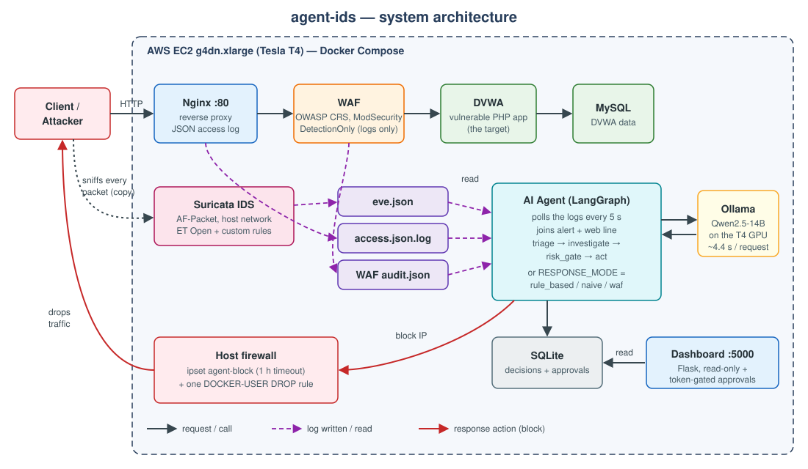

**Agent-IDS** is a lab that puts an **AI agent next to a classic intrusion detection system** and measures, with numbers,
whether the agent actually makes better decisions.

A vulnerable web application (**DVWA**) sits behind **Nginx** and an **OWASP CRS WAF**. **Suricata** watches the network
traffic and raises alerts. An **AI agent built with LangGraph** reads those alerts *and* the web server's access log, asks a
local LLM (**Qwen2.5-14B on Ollama**, running on an AWS GPU) what each request is, and decides to **log**, **warn** or
**block** the source IP. A **dashboard** shows every decision, and risky blocks can wait for a human to approve them.

The project then runs a **controlled A/B experiment**: the same 147 labeled requests are replayed against five
decision modes (plain IDS, block-every-alert, WAF, the agent, and the agent limited to IDS alerts), five times each, and
scored with confidence intervals.

This guide walks you through:

1. [Introduction](2.1-introduction/) — what the project is and what it found
2. [How it works](2.2-how-it-works/) — the components, the decision graph and the life of a request
3. [Prerequisites](2.3-prerequisites/) — the AWS machine and tools you need
4. [Deploy the stack](2.4-deploy-the-stack/) — from an empty GPU instance to a running system
5. [Try it](2.5-try-it/) — send attacks, watch decisions, approve blocks
6. [Run the benchmark](2.6-run-the-benchmark/) — reproduce the experiment
7. [Results](2.7-results/) — the numbers and how to read them
8. [Errors and fixes](2.8-errors-and-fixes/) — every problem hit while building it
9. [Notes and limitations](2.9-notes-and-limitations/) — what to keep in mind
10. [Clean up](2.10-clean-up/) — stop paying for the GPU
